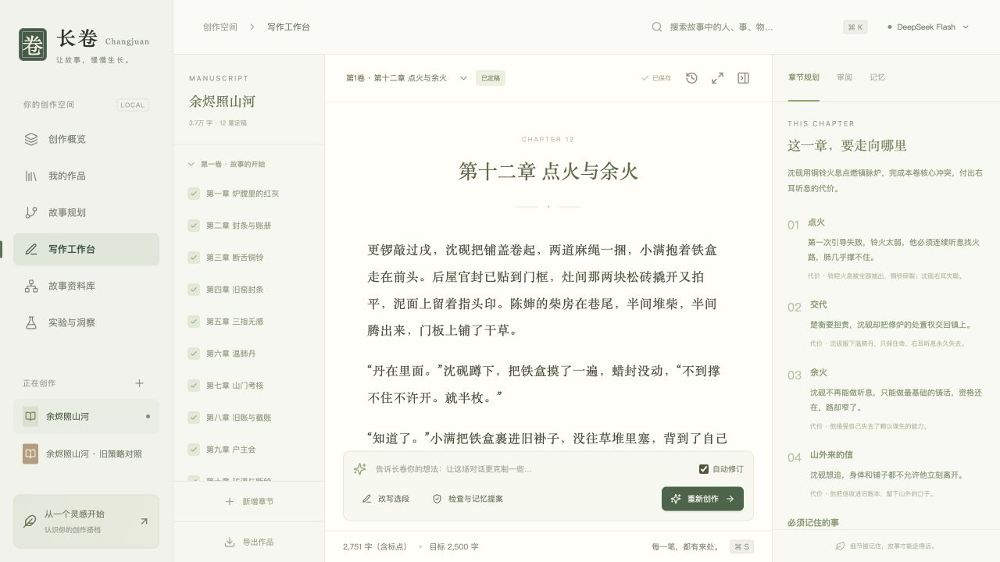
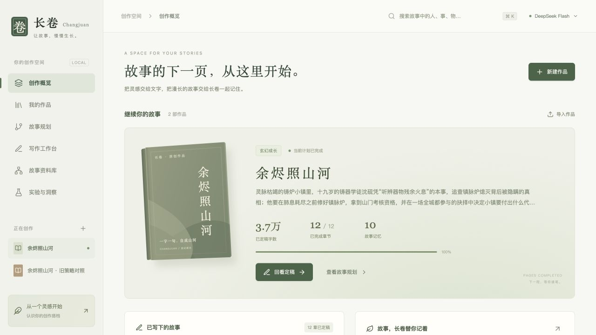
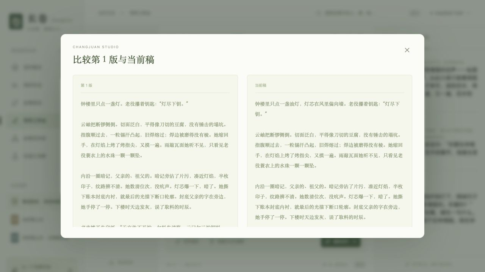

<p align="center">
  
</p>

<h1 align="center">长卷 · Changjuan</h1>

<p align="center">
  <strong>有记忆、可审阅的长篇小说创作工作台</strong><br>
  从一个灵感，到下一章。你决定故事的方向，长卷帮你记住沿途的细节。
</p>

<p align="center">
  <a href="LICENSE"></a>
  <a href="pyproject.toml"></a>
  <a href="web/package.json"></a>
  <a href="#data"></a>
</p>

<p align="center">
  <a href="#start">快速开始</a> ·
  <a href="#features">功能一览</a> ·
  <a href="docs/README.md">项目文档</a> ·
  <a href="CONTRIBUTING.md">参与贡献</a> ·
  <a href="https://github.com/XXiangYue/changjuan/issues">问题反馈</a>
</p>

---

长篇写作需要持续照顾人物、设定、伏笔与前后因果。长卷把**故事规划 → 章节创作 → 编辑审阅 → 记忆确认**放进同一个工作台：你可以亲自写作、让 AI 续写或改写选段，再决定哪些文字和设定进入正式故事。

<p align="center">
  
  <br><sub>真实工作台截图 · 展示作品为开发验收样书，新安装从空白书架开始。</sub>
</p>

<a id="features"></a>

## 为长篇创作准备

| 创作时的需要 | 长卷如何协助 |
| :--- | :--- |
| **先想好，再下笔** | 从故事方向生成全书蓝图、分卷安排与章节场景；目标和约束随时可改。 |
| **记得前文，接得上下一章** | 核心记忆、上一章全文、近期摘要与历史检索共同提供上下文；按章节时间和有效版本筛选依据。 |
| **写作与编辑在同一页** | 流式续写、选段改写、自动保存、专注模式与版本比较，让修改留在创作过程中。 |
| **让每次定稿有据可查** | 一致性与叙事两类编辑提供意见；正文、事实和记忆变化由作者审阅后确认。 |
| **改前文，也照顾后文** | 历史章重新定稿后，后续章节标记待复核；旧版本和原始来源可回看。 |
| **随时停下，再接着写** | 持久化检查点支持中断恢复；用量与费用估算可查，作品可导出 Markdown、TXT 或 ZIP。 |

<details>
<summary><strong>再看两处细节：作品概览与版本比较</strong></summary>

### 故事从这里继续

作品、章节进度与故事记忆集中在同一个书架。



### 改稿也保留来路

比较历史定稿与当前草稿。恢复旧版本会先成为草稿，经过审阅后再定稿。



</details>

<a id="start"></a>

## 快速开始

准备 **Python 3.12、[uv](https://docs.astral.sh/uv/getting-started/installation/)、Node.js 22+ 和 [pnpm 10+](https://pnpm.io/installation)**。以下命令适用于 macOS / Linux 的 shell；当前主要在 macOS 上验证，Windows 原生环境尚未验证。

```bash
git clone https://github.com/XXiangYue/changjuan.git
cd changjuan

# 安装后端与前端依赖
UV_CACHE_DIR="$PWD/.cache/uv" uv sync --frozen --extra dev
pnpm --dir web install --frozen-lockfile --store-dir "$PWD/.cache/pnpm"

# 构建界面并打开工作台
pnpm --dir web build
.venv/bin/novel-agent serve --open
```

打开 [http://127.0.0.1:8765](http://127.0.0.1:8765)，进入左下角 **「模型与设置」**，填写 DeepSeek API Key 并测试连接。也可以复制 `.env.example` 为 `.env`，填写 `DEEPSEEK_API_KEY`。

> [!NOTE]
> 当前代码使用 DeepSeek 官方接口和 `deepseek-flash` 模型，需要账号具备相应访问权限。生成和模型审阅会产生 API 费用；应用在本地运行，调用时会把所需的正文与上下文发送给模型服务。

安装完成后，可直接运行 `.venv/bin/novel-agent serve --open`。macOS 也可以双击 **启动长卷.command**；该快捷入口依赖 zsh、uv 和 pnpm。

### 写下第一章

1. **新建作品**：填写故事方向、文风、章数与目标字数。
2. **确认蓝图**：在「故事规划」中生成并调整全书方向、场景与核心记忆。
3. **创作正文**：在「写作工作台」亲自写作、AI 续写或改写选段。
4. **审阅定稿**：查看编辑意见，选择接受的事实和记忆变化，再确认本章。

接下来可以继续下一章、创建新卷或导出作品。完整操作见 [作者使用手册](docs/使用手册.md)。

## 故事如何被记住


规划、写作、编辑与记忆整理使用分开的上下文。正式状态在作者确认后统一提交；历史章改写会使后续旧状态失效，并提示逐章复核。

| 界面 | 服务与工作流 | 记忆与检索 |
| :--- | :--- | :--- |
| React · TypeScript · Tiptap | FastAPI · LangGraph · DeepAgents | SQLite · FTS5 · Qdrant · BGE |

默认使用关键词检索；可在设置中启用本地语义检索。首次启用需下载嵌入模型，索引保存在本地。技术细节见 [架构与接口](docs/架构与接口.md)；外部客户端接入见 [MCP 与技能边界](docs/MCP与技能边界.md)。

<a id="data"></a>

## 你的作品，保存在本地

| 位置 | 内容 |
| :--- | :--- |
| `data/` | 作品数据库、检查点、向量索引、正文与记忆镜像、导出文件 |
| `.local/settings.json` / `.env` | 本机模型配置与密钥 |
| `.cache/` | 模型与工具缓存 |
| `artifacts/` | 本地生成的实验结果与测试记录 |

这些目录和私有配置均被 Git 忽略。分享作品可以使用导出功能；完整备份请先停止服务，再复制 `data/`。ZIP 导出包含当前定稿和记忆，完整版本历史与运行记录保留在数据库中。

<details>
<summary><strong>使用前了解：当前能力边界</strong></summary>

- 面向单人本地创作，服务仅监听回环地址，没有账号体系和多人协作功能。
- 模型可能误解事实、漏掉矛盾或写出不合预期的内容；编辑评分与引文校验仍需作者判断，也不等于全网查重。
- 修改历史章节后，需要从最早的待复核章节向后处理。
- 中断发生在模型调用途中时，恢复可能重新请求该步骤并产生费用。
- 已有测试和评估输入用于检查工程行为与固定场景，不代表所有题材或百万字长篇的质量保证。

</details>

## 文档与开发

| 想了解什么 | 从这里开始 |
| :--- | :--- |
| 安装后怎样开始写作 | [作者使用手册](docs/使用手册.md) |
| 组件、数据和接口怎样协作 | [架构与接口](docs/架构与接口.md) |
| 为什么改前文会影响后文 | [历史改稿机制](docs/历史改稿机制.md) |
| 如何接入外部客户端 | [MCP 与技能边界](docs/MCP与技能边界.md) |
| 怎样运行测试和评估 | [评估方法](docs/评估方法.md) · [贡献指南](CONTRIBUTING.md) |

```text
changjuan/
├── src/novel_agent/   # Python 服务、工作流、记忆与检索
├── web/              # React 写作工作台
├── tests/            # 自动化测试
├── evaluations/      # 评估输入与协议
├── scripts/          # 开发、检查和评估工具
└── docs/             # 使用与技术文档、界面截图
```

有复现步骤的问题、文档修正和代码改进都欢迎提交。请先阅读 [贡献指南](CONTRIBUTING.md)，或通过 [GitHub Issues](https://github.com/XXiangYue/changjuan/issues) 反馈。

## 许可证

本项目采用 [MIT License](LICENSE)。

<p align="center"><sub>一字一句，自成山河。</sub></p>
